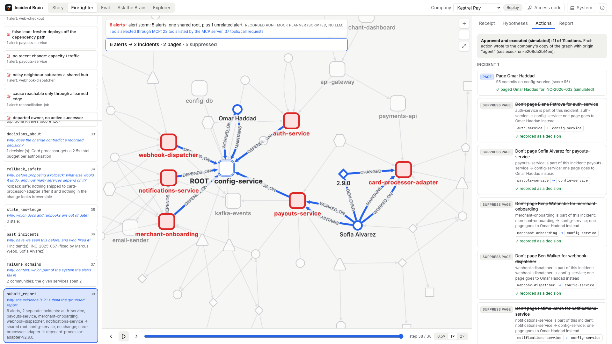

# Incident Brain

**An agent team that finds out why production broke, acts on it safely, and shows every step it took.**

▶ **Demo video: https://youtu.be/VdFsfqIWbUE**
🌐 **Live landing page: https://incident-brain-landing.vercel.app**

Built for the FalkorDB hackathon, **Track 1: Agents That Act on Connected Data**.



---

## How Incident Brain meets Track 1

**Multi-hop reasoning.** Track 1 asks for reasoning across connected data. The agent walks `DEPENDS_ON` edges in
FalkorDB from the alerting service to the change that caused it, using `algo.SPpaths`, and rejects fresher deploys that
have no path to the alert. See: Firefighter, the "false lead" scenario, Hypotheses tab.

**Graph queries and algorithms as tools.** Track 1 asks for the graph itself to be the agent's tool set. There are 22
fixed, parameterised Cypher tools on FalkorDB: BFS, shortest paths, WCC, PageRank, betweenness, label propagation and
full text search. The agent never writes its own queries. See: Firefighter, Alert storm, Receipt tab.

**Tool selection via MCP.** Track 1 asks for tools chosen through MCP. We built our own Incident Brain MCP server
(`backend/mcp_server.py`, stdio and HTTP at `/mcp/<tenant>/`). Our agent discovers and calls its tools through an MCP
session, and any MCP client can do the same: Claude Code connected to it and picked the tools itself, which is shown in
the video.

**Actions based on the graph.** Track 1 asks the agent to act, not just answer. Six alerts become two incidents and two
pages, with five suppressed and each suppression carrying the path that justifies it. It pages the person the graph
shows actually knows the code. A rollback safety check holds risky actions until a human approves, and execution runs on
a copy of the graph. See: Actions tab.

**Explainable results.** Track 1 asks for results you can check. Every step shows why that tool was chosen, the exact
Cypher, the parameters and the timing. Every lead is confirmed or rejected with evidence, and a report that cites
anything the graph did not return is refused.

**FalkorDB is the only data store. Remove it and the agent has nothing to reason over: the eval shows the right person
paged 19/19 with the graph vs 7/19 without, and 0 vs 15 wrong actions.**

---

## The problem, in plain words

A big company runs hundreds of small programs that call each other. When one of them breaks:

- Everything that was counting on it starts complaining at the same time, so one fault looks like twenty.
- The person who built the broken piece changed team or left the company a year ago.
- The reason a thing was built that way sits in a chat message nobody can find any more.

The first hour of an outage goes on working out where to even look. Incident Brain keeps a map of how the company fits
together, walks that map when an alarm goes off, names the change that broke things, wakes the one right person, and
writes down what it learned so the next time is faster.

## What it does, in one run

1. An alarm fires on a service. That is all the agent is told.
2. It walks the dependency chain downwards and finds a change two hops below, 40 minutes old.
3. It throws out the fresher changes the alarming service cannot reach, and records the query that killed each one.
4. It finds a dependency that was never written down, because an old chat thread describes it, and a written decision
   that the new change quietly contradicts.
5. It pages one person, chosen from who actually works on that service now, not the owner listed in a stale document.
6. It holds a risky rollback until a human approves it, then writes the learned dependency back into the graph.

## How it meets Track 1

| What the track asks for | How Incident Brain does it | Where to see it |
|---|---|---|
| **Multi-hop reasoning** | It follows `DEPENDS_ON` up to 6 hops from the alarm to the change that explains it, and keeps the path. | Firefighter view, the path drawn on the graph; `dependency_path`, `recent_changes_downstream`. |
| **Graph queries and algorithms as the agent's tools** | 22 fixed, parameterised read tools and 10 write tools. The agent picks a tool and fills its arguments; it never writes raw Cypher. Algorithms included: shortest paths, BFS, PageRank, betweenness, connected components, label propagation, full text search. | Any step's **Receipt** tab shows the exact Cypher and the timing. |
| **Tool selection via MCP** | The same registry is served over MCP (stdio and HTTP). The agent can run a whole investigation with its tools discovered and called through an MCP session. | `backend/mcp_server.py`, `docs/mcp.md`, `docs/mcp-transcript.md`; the playground labels runs that went through MCP. |
| **Actions based on the graph** | It pages a person, opens a ticket, flags an out of date document, links a similar past incident, and records what it learned. Every action is a write to the graph, and a risky rollback is held for human approval. | Firefighter view, **Actions** tab, including held actions with the safety check's reason. |
| **Explainable results** | Every step keeps why that tool was chosen, the Cypher it ran, the path it walked and the source text it quoted. Nothing in a report is allowed that is not grounded in a result. | **Hypotheses** tab (rejected leads with the evidence that killed them) and the Receipt on every step. |

## How FalkorDB is used

- **One graph per company.** Each tenant is its own FalkorDB graph, so no query can reach another company's data. The
  demo ships two: `kestrel_pay` (27 services) and `northwind_health` (9 services). The same agent code solves both.
- **The graph is the primary store, not a cache.** Services, people, teams, deploys, documents, tickets, chat threads,
  decisions, past incidents, runbooks and everything the agents write all live in it.
- **22 Cypher tools.** Fixed queries with parameter slots, listed with their Cypher and a verified example in
  `docs/cypher.md`. Writes use `MERGE` on `id`. Times are integer epoch seconds.
- **Algorithms:** `algo.SPpaths`, `algo.SSpaths`, `algo.BFS`, `algo.pageRank`, `algo.betweenness`, `algo.WCC`,
  `algo.labelPropagation` (CDLP), plus full text indexes over documents, tickets and chats.
- **Memory is graph state.** A learned dependency, a fact, a resolution or a new runbook is written back as nodes and
  edges tagged `origin:'agent'`, which the Explorer view shows in amber.

## Graph data model

**Node labels**

| Label | What it is |
|---|---|
| Service | One running program in the company. |
| Team | A team that owns services. |
| Person | Someone who works, or used to work, at the company. |
| Deploy | One change shipped to a service. |
| Doc | A written document about a service. |
| Ticket | A bug, task or follow up. |
| ChatThread | A team chat conversation, where buried reasons live. |
| Decision | A decision that was written down, with its rationale. |
| Incident | A past or current outage. |
| Resolution | How an incident was fixed, and by whom. |
| Runbook | A procedure for handling something, with versions. |
| RootCause | A recurring failure pattern shared by incidents. |
| PublicPostmortem | A real published outage report, for industry matching. |
| Fact | Something an agent learned and wrote back. |
| Session | One agent conversation, kept across runs. |
| Step | One step an agent took, with its tool, Cypher and reason. |

**Relationship types**

| Edge | Meaning |
|---|---|
| DEPENDS_ON | `(a)-[:DEPENDS_ON]->(b)` means a calls b. Carries whether it was declared or learned by an agent. |
| OWNS / MEMBER_OF | A team owns a service; a person belongs to a team. |
| MAINTAINS / WORKED_ON | The listed owner of a service, and who has actually committed to it. |
| DEPLOYED / CHANGED / FOR_TICKET | Who shipped a change, what it changed, and the ticket behind it. |
| AUTHORED / MENTIONS / DESCRIBES / ABOUT | Who wrote a source, and what it talks about. |
| SOURCED_FROM | The receipt: the exact source a decision, fact or runbook came from. |
| AFFECTED / CAUSED_BY / HAS_ROOT_CAUSE | What an incident hit, what caused it, and the pattern it belongs to. |
| RESOLVED_BY / PERFORMED_BY | How an incident ended, and who did it. |
| SIMILAR_TO | An agent written link between two incidents, with a score and a reason. |
| SUPERSEDES | A new runbook version replacing an old one. |
| FOR_INCIDENT / IN_SESSION | Ties an agent session and its steps to the incident it worked on. |

Full property lists, constraints and the planted demo stories: [`docs/schema.md`](docs/schema.md).

## Cypher queries and algorithms

The agent picks from these 22 read tools. Each one is a fixed Cypher query with parameter slots, shown with its
verified example output in [`docs/cypher.md`](docs/cypher.md). Ten write tools (page a person, open a ticket, record a
learned dependency, flag a stale document, write a runbook and so on) are documented there too.

| Tool | Algorithm used |
|---|---|
| `find_service` | plain Cypher |
| `blast_radius` | plain Cypher |
| `recent_changes_downstream` | `algo.SPpaths` |
| `recent_changes` | plain Cypher |
| `shared_dependency_changes` | plain Cypher |
| `dependency_path` | `algo.SPpaths` |
| `who_to_call` | plain Cypher |
| `decisions_about` | plain Cypher |
| `past_incidents` | plain Cypher |
| `search_knowledge` | `db.idx.fulltext.queryNodes` |
| `critical_services` | `algo.pageRank`, `algo.betweenness` |
| `stale_knowledge` | plain Cypher |
| `node_details` | plain Cypher |
| `read_source` | plain Cypher |
| `get_incident_state` | plain Cypher |
| `memory_recall` | plain Cypher |
| `industry_matches` | plain Cypher |
| `rollback_safety` | plain Cypher |
| `correlate_alerts` | `algo.BFS` and `algo.SPpaths` |
| `connected_impact` | `algo.WCC` and `algo.BFS` |
| `blast_tiers` | `algo.SSpaths` |
| `failure_domains` | `algo.labelPropagation` (CDLP) |


## Does the graph actually help? We measured it

Same agent, same loop, same report format, 15 hand written incident scenarios. The only thing that changes is which
tools the agent may use. An independent oracle (plain Python, no Cypher) re-derives every expected answer.

| Tools available | Scenarios solved | Causes right | Right person paged | Harmful actions suggested |
|---|---|---|---|---|
| Full Incident Brain | **15/15** | 19/19 | **19/19** | **0** |
| Graph, no algorithms | 12/15 | 16/19 | 16/19 | 13 |
| No graph (search + change log) | 0/15 | 13/19 | **7/19** | **15** |

Two more sets run the same way: 50 generated scenarios (full 50/50, no graph 0/50) and 6 written by an agent that had
never seen the planner (full 6/6, no graph 0/6). Full table and per scenario detail: [`docs/eval.md`](docs/eval.md).

In the alert storm, 6 alarms become 2 incidents and 2 pages instead of 6 pages and 5 people woken, and each suppressed
page keeps the dependency path that justifies it.

## Use it from Claude Code (MCP)

The tool registry is an MCP server, so Claude Code can query the company graph directly:

```bash
cd /ABS/PATH/incident-brain
claude mcp add incident-brain -e PYTHONPATH=/ABS/PATH/incident-brain -- \
  /ABS/PATH/incident-brain/.venv/bin/python -m backend.mcp_server --tenant kestrel_pay
claude mcp list            # incident-brain should show as connected
```

Then ask it, in Claude Code:

> payments-api is throwing 5xx errors. Use the incident-brain tools to find the likely cause, the dependency path, and
> who to call.

Claude picks the tools itself and answers with the dependency path and the person to page. A second company is just a
second server (`--tenant northwind_health`). Claude Desktop config and more example prompts are in
[`docs/mcp.md`](docs/mcp.md).

## An honest note on the agent's reasoning

The decisions in the demo, in the console and in the eval are made by a **deterministic rule planner in mock mode**.
No model is called, nothing is charged, and the same question always gives the same answer. An LLM planner is built and
swaps in behind the same interface, with the same tools, grounding checks and budget caps, but it was not run live for
this submission. Without an access code the web UI plays recorded runs and writes nothing. See
[`docs/live-mode.md`](docs/live-mode.md).

## Architecture

```
Console (React) · CLI · any MCP client
            |
     Agent loop  (RulePlanner | LLMPlanner, same interface)
            |
     Tool registry  (22 read + 10 write, fixed parameterised Cypher, receipt + ms per call)
            |
        FalkorDB  (one isolated graph per company)
```

Three agents share one incident node in the graph: **Triage** sorts the alarms, **Investigator** finds the cause,
**Communicator** writes it up. The hand-off is graph state, not a transcript, so every step is inspectable afterwards.
The FastAPI app serves both the API and the built frontend on one port.

## Install and run Incident Brain

### 1. Prerequisites

Docker Desktop, installed and running · Python 3.10 or newer (macOS ships 3.9, which is too old:
`brew install python@3.12`) · Node 18 or newer, needed only for the web UI · Git.
No API key is needed: everything below runs in mock mode, free.

### 2. Get the code

```bash
git clone https://github.com/jsuryacodes/incident-brain && cd incident-brain
```

### 3. Set up

```bash
scripts/setup.sh
```

This creates `.venv` and installs the dependencies, starts FalkorDB in a Docker container called `falkordb`, then
seeds and verifies both demo companies and generates the 2,000 service company used by the benchmarks. It takes a few
minutes. It is not stuck.

### 4. Start the console

```bash
scripts/ui.sh
```

Open **http://localhost:8000**, not :5173. The API and the UI are served from the same port, so there is no separate
dev server to start. Begin at **Firefighter**, pick the **Alert storm** scenario and press play.

Everything in Docker instead: `docker compose up --build`, same URL.

Without the UI, from the terminal:

```bash
source .venv/bin/activate
python -m backend.agents.firefighter --service svc:payments-api --symptom "5xx rate 12%"   # one investigation
python -m backend.agents.firefighter_eval      # the full eval, ~10 s
python -m backend.tools.benchmark              # timings on the 2,000 service company
scripts/demo.sh --quiet                        # the memory story
pytest -q                                      # 189 tests
```

### 5. Use it from Claude Code over MCP

Replace `<repo-path>` with the absolute path to your clone:

```bash
cd <repo-path>
claude mcp add incident-brain -e PYTHONPATH=<repo-path> -- \
  <repo-path>/.venv/bin/python -m backend.mcp_server --tenant kestrel_pay
claude mcp list            # incident-brain should show as Connected
```

Then ask it:

> payments-api is throwing 5xx errors. Use the incident-brain tools to find the likely cause, the dependency path, and
> who to call.

Claude picks the tools itself and comes back with the dependency path and the person to page. Add `--scope project` to
write the server into `.mcp.json` for everyone on the repo. A second company is just a second server:
`claude mcp add northwind -e PYTHONPATH=<repo-path> -- <repo-path>/.venv/bin/python -m backend.mcp_server --tenant northwind_health`.

### 6. Any other MCP client

Claude Desktop: Settings, Developer, Edit Config, then restart it.

```json
{
  "mcpServers": {
    "incident-brain": {
      "command": "<repo-path>/.venv/bin/python",
      "args": ["-m", "backend.mcp_server", "--tenant", "kestrel_pay"],
      "env": { "PYTHONPATH": "<repo-path>" }
    }
  }
}
```

The same tools are also served over HTTP by the running API at `http://localhost:8000/mcp/kestrel_pay/`, one endpoint
per company. More clients and example prompts: [`docs/mcp.md`](docs/mcp.md).

### 7. If something goes wrong

| Symptom | Fix |
|---|---|
| `ERROR: Docker is installed but not running` | Start Docker Desktop, wait for it to finish starting, re-run `scripts/setup.sh`. |
| `FalkorDB did not answer on localhost:6379` | Something else owns 6379, usually a local Redis: `lsof -i :6379`, stop it, then `docker rm -f falkordb` and re-run setup. |
| Port 8000 already in use | `PORT=8080 scripts/ui.sh`, then open http://localhost:8080. |
| `python: command not found`, or a Python 3.9 error | Use the venv: `source .venv/bin/activate`, or `python3`. `scripts/setup.sh` finds a 3.10 or newer interpreter by itself. |
| `need Node >= 18` from `scripts/ui.sh` | `brew install node`, or skip the UI and use the CLI commands above. |
| The Explorer or Ask the Brain looks empty | `scripts/ui.sh` plays the story once on a cold graph. If you seeded by hand, run `scripts/demo.sh --quiet` first. |
| MCP server shows as failed in `claude mcp list` | Check `<repo-path>` is absolute in both places, and that `scripts/setup.sh` finished so `.venv/bin/python` exists. |

## The console

| View | What it shows |
|---|---|
| **Story** | A full incident played back step by step, including the moment a learned dependency is written to the graph, and a before/after panel for the second session. |
| **Firefighter** | Point the agent at any alarm or scenario: live steps, the Hypotheses board, the Actions tab with safety holds, and a Receipt for every step. |
| **Eval** | The three tool sets side by side, per scenario. |
| **Ask the Brain** | Questions about the company, answered with the source text quoted and a warning when the person named has left. |
| **Explorer** | The whole graph, with everything an agent wrote highlighted in amber. |

## Repo layout

```
backend/     FastAPI app, agent loop and planners, tool registry, MCP server
  agents/    firefighter, the three agent team, the Brain, eval harnesses
  tools/     the 22 read tools and 10 write tools, one module per group
seed/        the two demo companies, scenario fixtures, the independent oracle, verification
frontend/    React console and the landing page (Vite, Tailwind, Playwright specs in e2e/)
scripts/     setup.sh, ui.sh, demo.sh, e2e.sh, live-check.sh
docs/        schema, every Cypher query, eval, MCP, benchmarks, progress log
tests/       189 pytest tests
```

## Documentation

| Document | What is in it |
|---|---|
| [`docs/schema.md`](docs/schema.md) | The graph model: every label, edge type and property, plus the planted demo stories. |
| [`docs/cypher.md`](docs/cypher.md) | Every tool with its Cypher, its algorithm and a verified example result. |
| [`docs/eval.md`](docs/eval.md) | The three tool sets, all scenarios, and what each one tests. |
| [`docs/mcp.md`](docs/mcp.md) | MCP setup for Claude Code and Claude Desktop, with example prompts. |
| [`docs/explain.md`](docs/explain.md) | How the agent loop, grounding and receipts work. |
| [`docs/benchmarks.md`](docs/benchmarks.md) | Timings on a generated 2,000 service company. |
| [`docs/live-mode.md`](docs/live-mode.md) | Mock versus live, the cost layers, and the first live run. |
| [`docs/demo-script.md`](docs/demo-script.md) | The shot list for the demo video. |
| [`docs/progress.md`](docs/progress.md) | What was built in each step, with a revert map. |

## AI assistance

Built solo, with Claude as a pair programmer: claude.ai for planning and design discussion, and Claude Code for the
implementation. I designed the graph schema, the incident scenarios, the tool set and the architecture, and I reviewed
every query it produced. A full step by step log of what was built with AI help, and what I was asked to double check,
is in [`docs/ai-log.md`](docs/ai-log.md).

## Licence

MIT.
