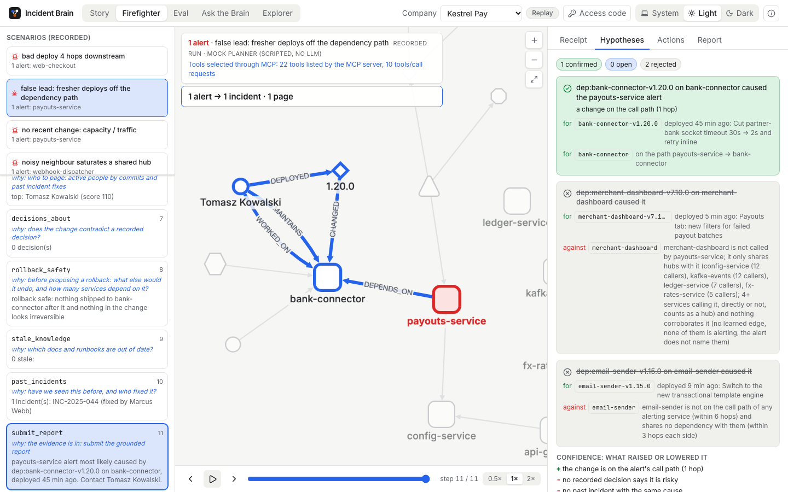
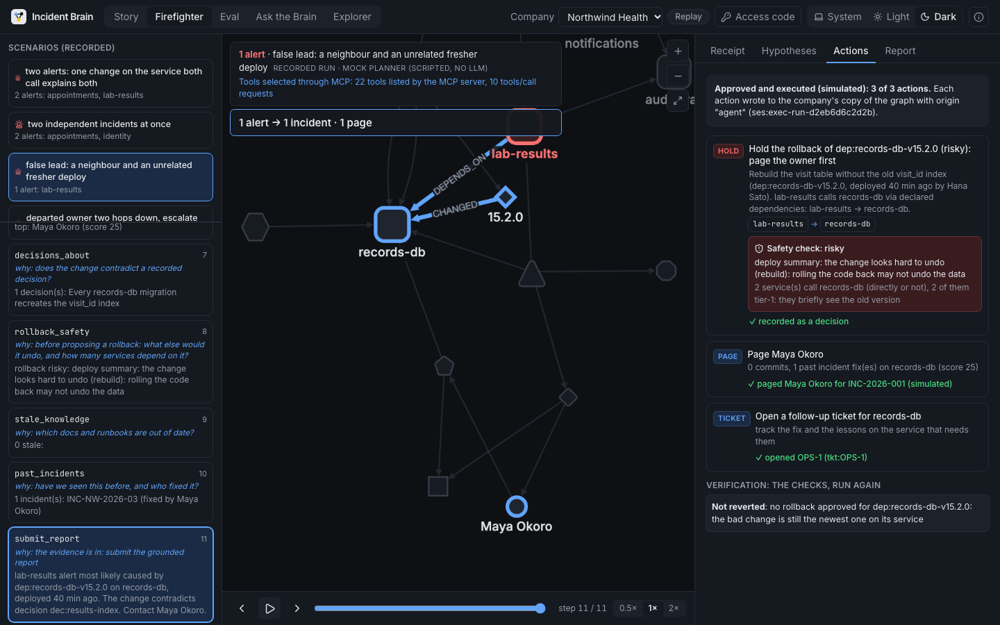
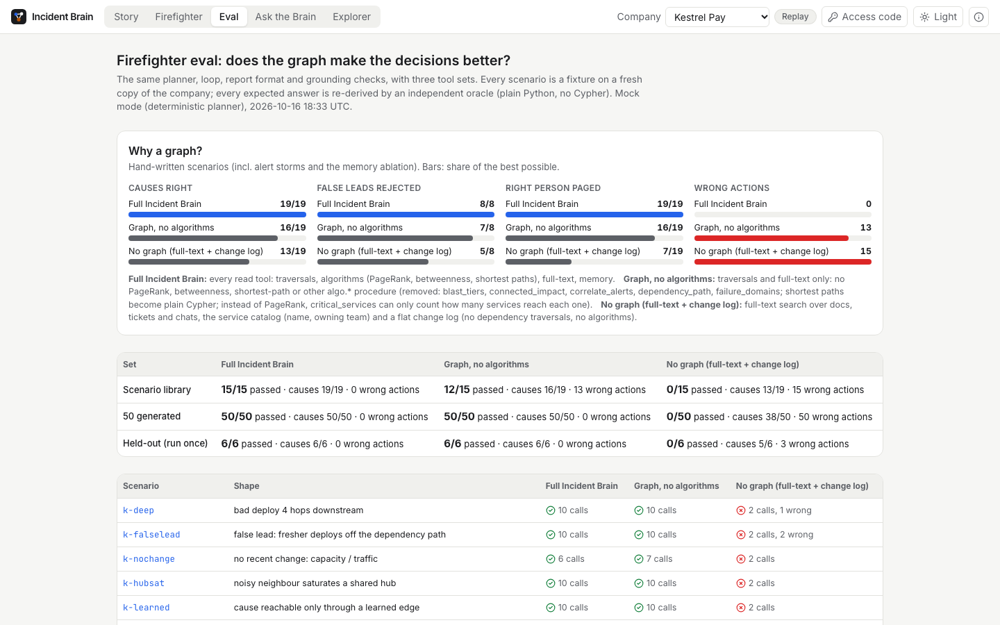
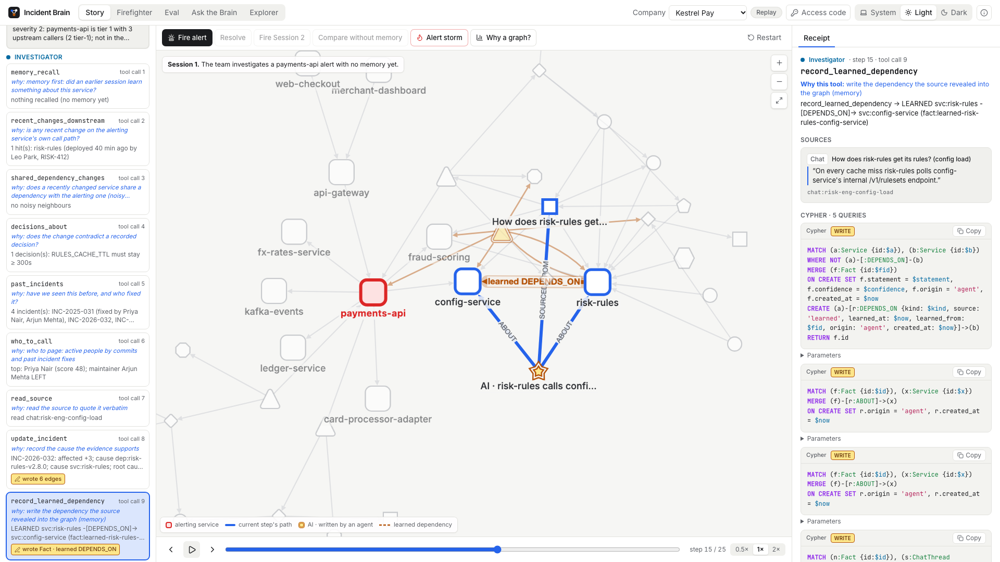
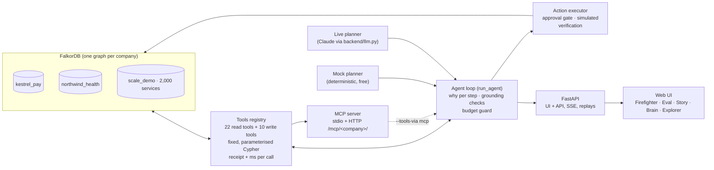
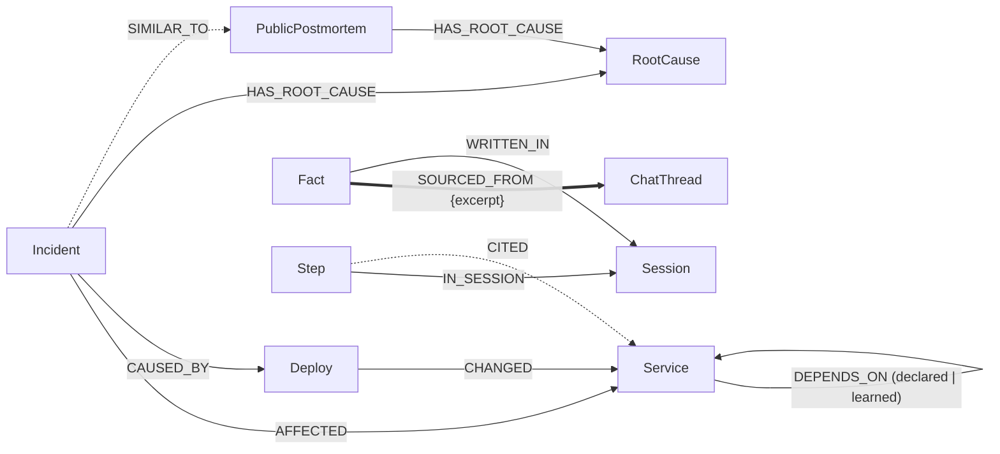

# Incident Brain

> Hackathon entry for **Track 1: Agents That Act on Connected Data** (FalkorDB). Placeholders are marked `TODO:`.

**Incident Brain is an incident-response agent that decides and acts from a company's knowledge graph in FalkorDB.**
When alerts fire, the Firefighter lists every recent change in the company as a lead, keeps or rejects each one by
walking the service dependency graph, correlates storms of alerts with graph algorithms, proposes a justified action
plan (with a safety check before any rollback), and executes it only after a person approves. Every step says *why*
it chose its tool, every claim cites a node, and every query comes back as a receipt. A team of agents (Triage →
Investigator → Communicator) uses the same tools and writes what it learns back into the graph, so the next incident is
solved because the graph changed.

- Demo video: `TODO: link`
- Live URL: `TODO: link`


<details>
<summary>More screenshots: hypotheses, the safety check, "why a graph?", the memory story</summary>





</details>

## Track 1: Agents That Act on Connected Data

The five official focus areas, and where each one shows:

- ✅ **Multi-hop reasoning.** The cause of an alert is found 1–6 hops down the dependency graph, through a shared
  dependency (noisy neighbour), or only through a dependency an earlier session *learned*. Fresher deploys that are not
  connected are rejected with the path evidence. **Where:** Firefighter view (`/firefighter`), any scenario;
  `seed/eval_scenarios.py` (e.g. `k-deep`: 4 hops, `k-learned`: learned edge only, `k-falselead`).
- ✅ **Graph queries and algorithms as agent tools.** 22 fixed, parameterised read tools (the agent picks the tool and
  its arguments, never writes Cypher): variable-length traversals, `algo.SPpaths`, `algo.SSpaths`, `algo.BFS`,
  `algo.WCC` (on a projection of the alerting subgraph), `algo.labelPropagation`, `algo.pageRank`,
  `algo.betweenness`, full-text search. Every call returns its exact Cypher and per-query time. **Where:** the Receipt
  tab of every step; [`docs/cypher.md`](docs/cypher.md) (each tool's real output from the running DB);
  [`docs/benchmarks.md`](docs/benchmarks.md) (hero vs a 2,000-service company).
- ✅ **Tool selection through MCP.** The same tools over MCP (stdio, and streamable HTTP at `/mcp/<company>/` in the
  API), with prompts (`investigate_alert`, `alert_storm`) and resources (schema, tool catalogue). Our own Firefighter
  can select and call every tool *through* an MCP session (`--tools-via mcp`), with a parity test against direct calls.
  **Where:** [`docs/mcp.md`](docs/mcp.md), [`docs/mcp-transcript.md`](docs/mcp-transcript.md).
- ✅ **Actions based on what the graph shows.** An action plan per incident (roll back / hold, page / escalate to the
  team, suppress duplicate pages, notify the silent callers, open a ticket, flag stale docs), each with its graph
  justification. `rollback_safety` checks later deploys and irreversible changes first; a risky rollback becomes
  "hold, page the owner". **Approve** (access code) executes in simulation on the run's copy of the company, then a
  verification step re-runs the checks. In the alert storm: **6 alerts → 2 incidents, 2 pages instead of 6, 5 pages
  suppressed with the dependency path as the reason.** **Where:** the Actions tab; the Story's *Alert storm* button.
- ✅ **Explainable results.** "Why this tool" on every step, a hypothesis board (every lead: supporting and
  contradicting evidence as node ids, status confirmed / rejected / open, the reason), a confidence breakdown, every
  rejected lead with the graph's reason, and receipts. **Where:** step cards, Hypotheses tab, Report tab.

**Does the graph make the decisions better?** The same planner, loop, report format and grounding checks with three
tool sets ([`docs/eval.md`](docs/eval.md), the Eval view): 15 hand-written scenarios (incl. 3 alert storms and the
memory ablation), 50 generated ones, and 6 held-out ones written by an agent that never saw the planner (run once:
6/6). Expected answers are re-derived by an independent oracle in plain Python, not by our tools.

| Mock planner, hand-written scenarios | Full Incident Brain | Graph, no algorithms | No graph (full-text + change log) |
|---|---|---|---|
| scenarios passed | **15/15** | 12/15 | 0/15 (no paths) |
| causes right | **19/19** | 16/19 | 13/19 |
| false leads rejected | **8/8** | 7/8 | 5/8 |
| right person paged | **19/19** | 16/19 | 7/19 |
| wrong actions recommended | **0** | 13 | 15 |
| generated (50) / held-out (6) passed | 50/50 · 6/6 | 50/50 · 6/6 | 0 · 0 |

Read honestly: the *graph* (traversals) is what finds and defends causes; without it, word matching names the right
deploy two times in three but takes the bait on false leads and pages the wrong people. The *algorithms* change the
outcome only in the alert storms (correlating many alerts at once); on single alerts plain traversals tie, and at
2,000 services both stay fast. All numbers are mock-mode (deterministic planner): live mode has not been run.

## 3-minute quickstart

Needs macOS or Linux, Docker Desktop, Python ≥ 3.10 and Node ≥ 18. No API key: everything runs in mock mode, for free.

```bash
git clone https://github.com/jsuryacodes/incident-brain && cd incident-brain
scripts/setup.sh          # .venv + deps, the 'falkordb' container, seeds + verifies both companies (+ the scale company)
scripts/ui.sh             # UI + API on http://localhost:8000
```
Or everything in Docker: `docker compose up --build`. One command checks the whole UI in a headless browser:
`scripts/e2e.sh`. The eval: `python -m backend.agents.firefighter_eval` (~10 s). Benchmarks:
`python -m backend.tools.benchmark`. The memory story in the terminal: `scripts/demo.sh --quiet`.

**Views**
- **Firefighter** (Track 1): pick a scenario (or, with the access code, your own alert) and watch the run: the graph
  grows step by step (alerting services red, the current path blue, a storm's shared root ringed), each step card says
  why its tool was chosen, and the drawer shows the receipt, the hypothesis board, the action plan (Approve +
  verification) and the report. Visitors watch recordings; with the code every run is fresh (mock).
- **Eval** (Track 1): "Why a graph?" bars for the three tool sets, the scoreboard, every scenario linked to its run, and
  the scale benchmarks.
- **Story** (Track 1 + 2): Triage → Investigator → Communicator on one alert, the learned dependency drawing itself in,
  Session 2 solved from memory, the before/after panel; buttons to the *Alert storm* and *Why a graph?*.
- **Ask the Brain** (Track 3) and **Explorer** (Track 2 + 3).

## Architecture



- **Agents never write Cypher.** They choose a tool and its arguments; every tool is a fixed, parameterised query
  (`graph.ro_query` for reads). Only label names checked against the schema are interpolated.
- **Grounding:** a report is rejected (one retry) if it cites an id no tool returned or quotes text that isn't
  literally in its source.
- **Actions never run on a hero company graph:** approval executes on the run's own twin graph, simulated, and writes
  only `origin: 'agent'` nodes with the existing labels.

## Graph data model

Full model, design rules and the Mermaid diagrams: **[`docs/schema.md`](docs/schema.md)** (locked, v1.3). In short:

- *Company map:* Person, Team, Service (`DEPENDS_ON {source: declared | learned}`), Deploy, Ticket, Doc, ChatThread,
  Decision.
- *Episodic and procedural memory:* Incident, Resolution, Runbook (`SUPERSEDES` versions), RootCause, PublicPostmortem.
- *Agent memory:* Fact, Session, Step. Everything agents write has `origin: 'agent'`; every claim points to its source
  with `SOURCED_FROM {excerpt}` (the receipt).



## The Cypher and algorithms the product depends on

All queries, with explanations and real output, are generated from the registry into **[`docs/cypher.md`](docs/cypher.md)**.

| FalkorDB feature | Used by | What for |
|---|---|---|
| Variable-length paths `[:DEPENDS_ON*0..N]` | `recent_changes_downstream`, `shared_dependency_changes`, `blast_radius`, `memory_recall` | what changed on the call path, noisy neighbours, who is hurt, memory scope |
| `algo.SPpaths` | `recent_changes_downstream`, `dependency_path`, `correlate_alerts` | the shortest dependency path, hop by hop with `source` (declared/learned) |
| `algo.BFS` | `correlate_alerts`, `connected_impact` | what each alerting service reaches, in one query for all alerts |
| `algo.WCC` on a projection | `connected_impact` | which alerts cannot share a cause (different components) |
| `algo.SSpaths` (incoming) | `blast_tiers` | callers per tier: who alerts next (notify, don't page) |
| `algo.pageRank` / `algo.betweenness` | `critical_services` | where to look first when nothing changed; chokepoints |
| `algo.labelPropagation` | `failure_domains` | communities (context only) |
| Full-text `db.idx.fulltext.queryNodes` | `search_knowledge` | docs, tickets, chats, decisions, incidents, runbooks |

FalkorDB notes we hit: a `MATCH` after `WITH … aggregate` silently returns nothing (aggregation always last);
FalkorDB 6.0.2 crashed the server on an aggregation with ~11 columns and NULLs (we keep rows narrow; minimal repro in
the progress log); whole-graph `algo.WCC` is one component in a hub-heavy graph, so we project the alerting subgraph
into a scratch graph first (a few ms).

## How memory works

1. **Session 1** (payments-api alert): the Investigator follows declared `DEPENDS_ON` edges down to a 40-minute-old
   deploy of risk-rules that lowered `RULES_CACHE_TTL` 300s → 5s. That contradicts a decision whose source is a chat
   thread, so it reads the thread and finds: *"On every cache miss risk-rules polls config-service's internal
   /v1/rulesets endpoint."* The catalog doesn't have that dependency, so it writes `(risk-rules)-[:DEPENDS_ON
   {source:'learned'}]->(config-service)` plus a `Fact` that quotes the sentence.
2. **Resolve:** the operator says Priya fixed it. The postmortem pass writes a Resolution, Runbook v2 (`SUPERSEDES`
   v1) and `SIMILAR_TO` links to past incidents and to matching public postmortems.
3. **Session 2** (payouts-service alert, a different service): the Investigator calls `memory_recall` first. Because
   of the learned edge, risk-rules now shares config-service with payouts-service, and memory says it caused INC-2026-032.
   It verifies that one hypothesis (risk-rules shipped v2.8.1 five minutes ago) and names the cause on its 3rd tool call:
   *"Seen before: INC-2026-032, fixed by Priya Nair (Priya rolled back RULES_CACHE_TTL to 300s; config-service load
   recovered), see Runbook v2 step 2."*

Before/after, mock mode (`scripts/demo.sh --quiet`):

| | Session 1 | Session 2 (with memory) | Session 2 without memory |
|---|---|---|---|
| cause found | `dep:risk-rules-v2.8.0` | `dep:risk-rules-v2.8.1` | **not found** (confidence low) |
| Investigator tool calls until cause | 8 | **3** | — |
| tool calls from session start (incl. Triage) | 14 | 9 | — |
| LLM calls until cause | 8 | 6 | — |

The honest headline: without Session 1's memory, the same agents with the same tools **cannot** find the cause,
because nothing in the declared graph connects payouts-service to risk-rules. With memory they find it in three
Investigator calls. Memory is a hypothesis to verify, never a shortcut: if the suspect hadn't changed recently, the
agent would fall back to the full scan.

## Track 2: Agent Memory and Coordination
`TODO: paste the official focus bullets and tick them off.`
- **Memory changes the graph's structure:** learned `DEPENDS_ON` edges + `Fact`s with sources; episodic memory
  (Incident, Resolution, `SIMILAR_TO`), procedural memory (Runbook versions via `SUPERSEDES`).
- **Memory-first recall:** `memory_recall` returns only what agents wrote, so a first session honestly recalls nothing.
- **Coordination through the graph:** Triage → Investigator → Communicator each start with an empty conversation
  and read the shared incident state (`get_incident_state`); handoffs are `Step` nodes chained by `NEXT`, so the
  team is inspectable, replayable (`/api/sessions/{id}`) and crash-safe.
- **High-concurrency writes:** incident/ticket keys and learned edges are allocated and created in one query; 5
  parallel team runs give 5 distinct incidents and exactly 1 learned edge (`tests/test_memory.py`).
- **Separate memory per tenant:** one FalkorDB graph per company (see below).

## Track 3: Company Brain
`TODO: paste the official focus bullets and tick them off.`
- **Ask the Brain** (`python -m backend.agents.brain ask "..."`, `POST /api/brain/ask`): why did we decide X (with
  the exact quote), who knows X now that someone left (computed from commits + incident fixes, not stored), who owns
  X, what breaks if X fails, have we seen this before, what did an agent session learn, which public postmortems
  match our pattern, onboarding reading lists, stale docs (and it flags them).
- **Conversation memory in the graph:** follow-ups ("who should I talk to about that?") work after a restart; each
  session belongs to one user.
- **Honest:** at least one verbatim citation per answer, or "I don't know". Eval: **15/15** Kestrel Pay questions
  and **3/3** Northwind Health questions in mock mode (`backend/agents/brain_eval.py`).
- **Industry pattern layer:** 21 real public postmortems (Cloudflare, AWS, Google Cloud, GitHub, Slack, …) with our
  own summaries, in every tenant ([`docs/postmortems.md`](docs/postmortems.md)).

## Modes and cost
- **Mock (default, free):** a deterministic planner plays every agent through the same loop, tools and checks. **All
  numbers in this README are mock numbers.**
- **Live:** Claude (`claude-haiku-5-5` by default) through one wrapper with `max_tokens`, prompt caching, a per-run
  budget guard and step limits; on the API an access code, a daily cap and a rate limit. **Live mode has not been run
  yet.** One command validates it later for about $0.15: `scripts/live-check.sh` ([`docs/live-mode.md`](docs/live-mode.md)).

## MCP
```bash
claude mcp add incident-brain -e PYTHONPATH=$PWD -- $PWD/.venv/bin/python -m backend.mcp_server --tenant kestrel_pay
# or, with scripts/ui.sh running: streamable HTTP at http://localhost:8000/mcp/kestrel_pay/
```
Read tools only (no writes, no agent runs, no API spend). Details: [`docs/mcp.md`](docs/mcp.md).

## Tenant isolation
Each company is its own FalkorDB graph (`kestrel_pay`, `northwind_health`, and the generated `scale_demo`; allowlist in `TENANTS`). Agent memory
lives inside the tenant's graph, so a query on Northwind physically cannot traverse into Kestrel Pay: there is no
filter to forget. The demo ends by asking Northwind's Brain about Kestrel's `RULES_CACHE_TTL`: "I don't know". The
API takes a tenant per request; the MCP server is pinned to one tenant per process. Both datasets are synthetic; the
public postmortems are the only real-world data, and they are copied into every tenant.

## Repo map
| Path | What |
|---|---|
| `backend/tools/` | graph read tools, storm (algorithm) tools, memory write tools, registry, receipts, docs export, benchmarks |
| `backend/agents/` | agent loop, Firefighter + its planner (`ff_policy.py`), team, Brain, actions executor, MCP toolbox, eval + baselines, playground, prompts |
| `backend/api/`, `backend/mcp_server.py` | FastAPI app (API, UI, MCP over HTTP), UI read models, MCP server |
| `frontend/` | React + Vite + TypeScript UI (Cytoscape), vitest, Playwright e2e |
| `seed/` | schema, loader, verify, the companies (incl. the generated scale one), eval scenarios, oracle, generator, held-out set |
| `docs/` | schema, Cypher, eval, benchmarks, MCP + transcript, live mode, deploy, demo script, explain, screenshots, progress, AI log |

## Built with an AI assistant
This project was built with Claude Code (Anthropic), with Jaya directing, reviewing and deciding. Each step's spec is
in `docs/prompts/`, and **[`docs/ai-log.md`](docs/ai-log.md)** records what the assistant built at each step and what
a human should double-check. The product itself uses Claude only through `backend/llm.py`, and only in live mode.
