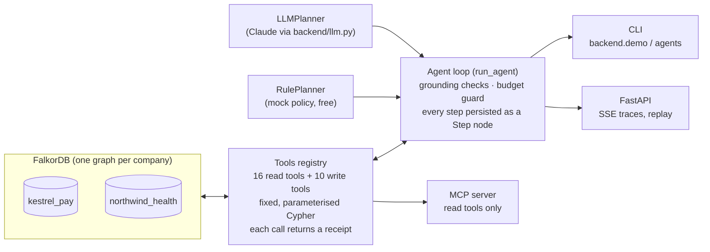
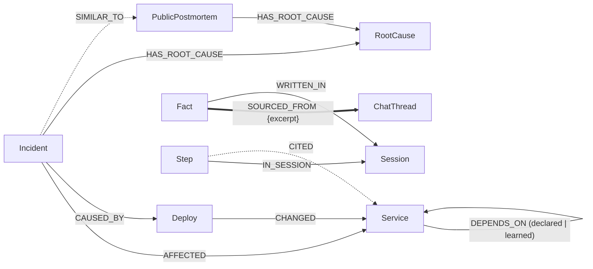

# Incident Brain

> **Draft README** for the FalkorDB hackathon. Placeholders are marked `TODO:`.

**Incident Brain is a team of AI agents that respond to production incidents using a company's knowledge graph in
FalkorDB, and that write what they learn back into that graph.** When an alert fires, a Triage agent sizes it, an
Investigator walks the service dependency graph to the recent change that caused it, and a Communicator pages the right
*active* person and opens the follow-up. They hand off to each other through the graph, not through chat. When an
investigator finds something the graph didn't know (for example "risk-rules calls config-service", buried in a
14-month-old chat thread), it writes a learned `DEPENDS_ON` edge with the quote that proves it. The next incident is
solved *because the graph's structure changed*. The same graph also answers company questions ("why did we decide
this?", "who knows this now that Arjun left?") with verbatim, cited sources, and links incidents to real public
postmortems from other companies.

- Demo video: `TODO: link`
- Live URL: `TODO: link`
- Screenshots: `TODO: graph view with agent-written memory highlighted; Session 1 vs Session 2 trace`

## 3-minute quickstart

Needs macOS or Linux, Docker Desktop, and Python ≥ 3.10. No API key: everything runs in mock mode, for free.

```bash
git clone https://github.com/jsuryacodes/incident-brain && cd incident-brain
scripts/setup.sh          # .venv + pinned deps, starts the 'falkordb' container, seeds + verifies both companies
scripts/demo.sh --quiet   # the whole story: Session 2 without memory, Session 1, resolve, Session 2 with memory
```

Then look at the memory in the FalkorDB Browser (http://localhost:3000, graph `kestrel_pay`):
`MATCH (n {origin:'agent'})-[r]-(m) RETURN n,r,m`.

More: `scripts/demo.sh` (every tool call), `python -m backend.agents.brain_eval` (15 company questions),
`uvicorn backend.api.main:app` (API + live trace over SSE), `pytest -q` (≈100 tests, network blocked).

## Architecture



- **Agents never write Cypher.** They choose a tool and its arguments. Every tool is a fixed, parameterised query
  (`graph.ro_query` for reads). Only label names checked against the schema are ever interpolated.
- **One loop for every agent** (Firefighter, Triage, Investigator, Communicator, postmortem, Brain): LLM turn → run
  every tool call → results back → repeat until the agent submits. A submit is rejected (one retry) if it cites an id
  that no tool returned, or quotes text that isn't literally in its source.
- **Planner is pluggable.** The mock "RulePlanner" (`backend/agents/mock_policy.py`) derives each next call from the
  tool results, so the whole product runs and is tested for free; the live planner is Claude through the single
  wrapper `backend/llm.py`.

## Graph data model

Full model, design rules and the Mermaid diagrams: **[`docs/schema.md`](docs/schema.md)** (locked, v1.2). In short:

- *Company map:* Person, Team, Service (`DEPENDS_ON {source: declared | learned}`), Deploy, Ticket, Doc, ChatThread,
  Decision.
- *Episodic and procedural memory:* Incident, Resolution, Runbook (`SUPERSEDES` versions), RootCause, PublicPostmortem.
- *Agent memory:* Fact, Session, Step. Everything agents write has `origin: 'agent'`; every claim points to its source
  with `SOURCED_FROM {excerpt}` (the receipt).



## The Cypher and algorithms the product depends on

All queries, with explanations, are generated from the registry into **[`docs/cypher.md`](docs/cypher.md)**.

| FalkorDB feature | Used by | What for |
|---|---|---|
| Variable-length paths `[:DEPENDS_ON*1..N]` | `blast_radius`, `recent_changes_downstream`, `shared_dependency_changes`, `memory_recall` | who is hurt, what changed downstream, noisy neighbours, memory scope |
| `algo.SPpaths` | `recent_changes_downstream`, `dependency_path` | shortest dependency path per hit, with each hop's `source` (declared/learned) |
| `algo.pageRank` | `critical_services` (Triage) | shared dependencies everything relies on |
| `algo.betweenness` | `critical_services` | chokepoints on many call paths |
| Full-text `db.idx.fulltext.queryNodes` | `search_knowledge` (Brain) | docs, tickets, chats, decisions, incidents, runbooks, root causes |
| `MERGE` on `id`, single-query allocation | write tools | concurrent agents can't duplicate keys or learned edges |

FalkorDB notes we hit: a `MATCH` after `WITH … aggregate` silently returns nothing, so aggregation is always the last
step; full-text indexes use `CREATE FULLTEXT INDEX FOR (n:Label) ON (n.a, n.b)`.

## How memory works

1. **Session 1** (payments-api alert): the Investigator follows declared `DEPENDS_ON` edges down to a 40-minute-old
   deploy of risk-rules that lowered `RULES_CACHE_TTL` 300s → 5s. That contradicts a decision whose source is a chat
   thread, so it reads the thread and finds: *"On every cache miss risk-rules polls config-service's internal
   /v1/rulesets endpoint."* The catalog doesn't have that dependency, so it writes `(risk-rules)-[:DEPENDS_ON
   {source:'learned'}]->(config-service)` plus a `Fact` that quotes the sentence.
2. **Resolve:** the operator says Priya fixed it. The postmortem pass writes a Resolution, Runbook v2 (`SUPERSEDES`
   v1) and `SIMILAR_TO` links to past incidents and to matching public postmortems.
3. **Session 2** (payouts-service alert, a different service): the Investigator calls `memory_recall` first. Because
   of the learned edge, risk-rules now shares config-service with payouts-service, and memory says it caused INC-2026-032.
   It verifies that one hypothesis (risk-rules shipped v2.8.1 five minutes ago) and names the cause on its 3rd tool call:
   *"Seen before: INC-2026-032, fixed by Priya Nair (Priya rolled back RULES_CACHE_TTL to 300s; config-service load
   recovered), see Runbook v2 step 2."*

Before/after, mock mode (`scripts/demo.sh --quiet`):

| | Session 1 | Session 2 (with memory) | Session 2 without memory |
|---|---|---|---|
| cause found | `dep:risk-rules-v2.8.0` | `dep:risk-rules-v2.8.1` | **not found** (confidence low) |
| Investigator tool calls until cause | 8 | **3** | — |
| tool calls from session start (incl. Triage) | 14 | 9 | — |
| LLM calls until cause | 8 | 6 | — |

The honest headline: without Session 1's memory, the same agents with the same tools **cannot** find the cause,
because nothing in the declared graph connects payouts-service to risk-rules. With memory they find it in three
Investigator calls. Memory is a hypothesis to verify, never a shortcut: if the suspect hadn't changed recently, the
agent would fall back to the full scan.

## Track 1: Agents That Act on Connected Data
`TODO: paste the official focus bullets and tick them off.`
- Agents act through **16 graph read tools and 10 validated write tools**, not free-form queries: traversals
  (`blast_radius`, `recent_changes_downstream`, `shared_dependency_changes`), FalkorDB algorithms (`algo.SPpaths`,
  `algo.pageRank`, `algo.betweenness`), full-text search.
- They **act**: open incidents, set causes, page people (refusing anyone who left), open tickets, flag stale docs,
  write runbooks. Every write checks that ids exist with the right label and that quotes are literal.
- **Tool selection via MCP:** `python -m backend.mcp_server --tenant kestrel_pay` exposes every read tool to Claude
  Desktop / Claude Code with a Cypher receipt per call ([`docs/mcp.md`](docs/mcp.md)).
- **Receipts:** each step is a `Step` node with the exact Cypher, parameters and `CITED` edges to the nodes it used.

## Track 2: Agent Memory and Coordination
`TODO: paste the official focus bullets and tick them off.`
- **Memory changes the graph's structure:** learned `DEPENDS_ON` edges + `Fact`s with sources; episodic memory
  (Incident, Resolution, `SIMILAR_TO`), procedural memory (Runbook versions via `SUPERSEDES`).
- **Memory-first recall:** `memory_recall` returns only what agents wrote, so a first session honestly recalls nothing.
- **Coordination through the graph:** Triage → Investigator → Communicator each start with an empty conversation
  and read the shared incident state (`get_incident_state`); handoffs are `Step` nodes chained by `NEXT`, so the
  team is inspectable, replayable (`/api/sessions/{id}`) and crash-safe.
- **High-concurrency writes:** incident/ticket keys and learned edges are allocated and created in one query; 5
  parallel team runs give 5 distinct incidents and exactly 1 learned edge (`tests/test_memory.py`).
- **Separate memory per tenant:** one FalkorDB graph per company (see below).

## Track 3: Company Brain
`TODO: paste the official focus bullets and tick them off.`
- **Ask the Brain** (`python -m backend.agents.brain ask "..."`, `POST /api/brain/ask`): why did we decide X (with
  the exact quote), who knows X now that someone left (computed from commits + incident fixes, not stored), who owns
  X, what breaks if X fails, have we seen this before, what did an agent session learn, which public postmortems
  match our pattern, onboarding reading lists, stale docs (and it flags them).
- **Conversation memory in the graph:** follow-ups ("who should I talk to about that?") work after a restart; each
  session belongs to one user.
- **Honest:** at least one verbatim citation per answer, or "I don't know". Eval: **15/15** Kestrel Pay questions
  and **3/3** Northwind Health questions in mock mode (`backend/agents/brain_eval.py`).
- **Industry pattern layer:** 21 real public postmortems (Cloudflare, AWS, Google Cloud, GitHub, Slack, …) with our
  own summaries, in every tenant ([`docs/postmortems.md`](docs/postmortems.md)).

## Modes and cost
- **Mock (default, free):** a rule-based planner plays every agent through the same loop, tools and checks. All
  numbers in this README are mock numbers.
- **Live:** Claude (`claude-haiku-5-5` by default) through one wrapper with `max_tokens`, prompt caching, a per-run
  budget guard, step limits, and on the API an access code + daily cap + rate limit. **Live mode has not been run yet.**
  Details: [`docs/live-mode.md`](docs/live-mode.md).

## MCP
```bash
claude mcp add incident-brain -e PYTHONPATH=$PWD -- $PWD/.venv/bin/python -m backend.mcp_server --tenant kestrel_pay
```
Read tools only (no writes, no agent runs, no API spend). Claude Desktop config and example prompts: [`docs/mcp.md`](docs/mcp.md).

## Tenant isolation
Each company is its own FalkorDB graph (`kestrel_pay`, `northwind_health`; allowlist in `TENANTS`). Agent memory
lives inside the tenant's graph, so a query on Northwind physically cannot traverse into Kestrel Pay: there is no
filter to forget. The demo ends by asking Northwind's Brain about Kestrel's `RULES_CACHE_TTL`: "I don't know". The
API takes a tenant per request; the MCP server is pinned to one tenant per process. Both datasets are synthetic; the
public postmortems are the only real-world data, and they are copied into every tenant.

## Repo map
| Path | What |
|---|---|
| `backend/tools/` | graph read tools, memory write tools, registry, receipts, doc export |
| `backend/agents/` | agent loop, team, Firefighter, Brain, mock planner, prompts, evals |
| `backend/api/`, `backend/mcp_server.py` | FastAPI app, MCP server |
| `seed/` | schema, loader, verify checks, Kestrel Pay + Northwind Health data, public postmortems |
| `docs/` | schema, Cypher, postmortems, MCP, live mode, progress, AI log |

## Built with an AI assistant
This project was built with Claude Code (Anthropic), with Jaya directing, reviewing and deciding. Each step's spec is
in `docs/prompts/`, and **[`docs/ai-log.md`](docs/ai-log.md)** records what the assistant built at each step and what
a human should double-check. The product itself uses Claude only through `backend/llm.py`, and only in live mode.
