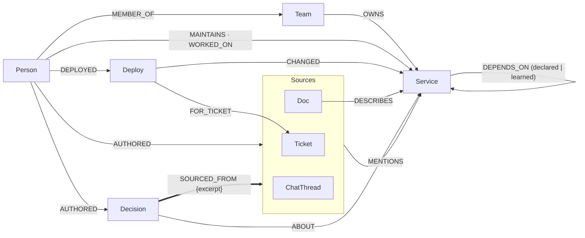
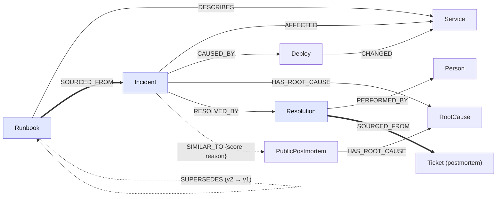
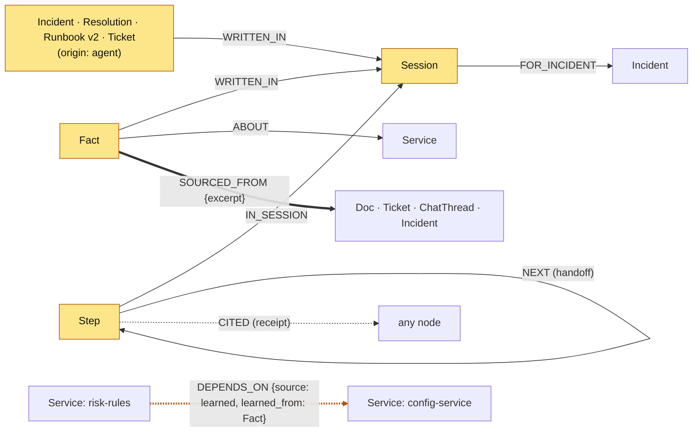

# Incident Brain — Graph Schema (LOCKED v1.1 · 15 Oct 2026)

This file is the single source of truth for the graph model. Code must follow it.
Changing it requires a deliberate decision (bump the version + note why at the bottom).

## 1. Shape of the system

- **One FalkorDB graph per tenant (company).** First tenant: `kestrel_pay`. A second tenant comes later (build step 10).
- Agent memory lives **inside the tenant's graph**. Tenant isolation of memory is therefore automatic: an agent running on graph B cannot see anything learned on graph A.
- Two layers in one graph:
  - **Seeded world** (`origin: 'seed'`): the company as it exists before the demo.
  - **Agent-written memory** (`origin: 'agent'`): nodes/edges the agents create at runtime. The UI colours these differently: this is how "memory" becomes visible.

## Data model at a glance

GitHub renders these diagrams. Yellow = agent-written memory (`origin: 'agent'`); blue-tinted = written by both the seed and agents. Thick arrows = `SOURCED_FROM` (the receipts).

**1. The company map** (who owns what, what depends on what, where knowledge lives)



**2. Incidents and how they were fixed** (episodic + procedural memory)



**3. Agent memory and sessions** (what agents write at runtime; the orange dotted edge is the dependency learned in Session 1)



## 2. Design rules (the talking points)

1. **Two layers, one graph.** Every node has `origin` = `'seed'` or `'agent'`.
2. **One provenance edge: `SOURCED_FROM`.** Every claim (Decision, Fact, Resolution, Runbook) points at the Doc / Ticket / ChatThread / Incident it came from, with the quoted `excerpt` on the edge. "Show the receipt" is always a one-hop query.
3. **Expertise is computed, not stored.** No `KNOWS` edge. "Who knows X" = traversal over `WORKED_ON`, `MAINTAINS`, `AUTHORED`, `MENTIONS`.
4. **Learning changes the graph's structure.** When an agent discovers an undocumented dependency it writes `DEPENDS_ON {source:'learned'}` plus a `Fact` with sources. Next session, traversals find things *because of* that edge.
5. **Conventions:**
   - `id`: string, globally unique, **prefixed by label** (table below). Writes use `MERGE` on `id`, so concurrent agents don't create duplicates.
   - All times are **integer epoch seconds (UTC)**, named `*_at` or `ts`. Range-indexable, trivially comparable (`dep.ts > $since`).
   - Properties `snake_case`, labels `PascalCase`, edge types `UPPER_SNAKE`.
   - Queries are always **parameterised** (`$id`, `$since`), never string-built.

## 3. Node labels

Common properties on every node: `id`, `origin` ('seed' | 'agent'), `created_at`.

| Label | id prefix | Layer | Properties (besides common) | Why it exists |
|---|---|---|---|---|
| Team | `team:` | seed | name | ownership, onboarding |
| Person | `per:` | seed | name, role, email, status ('active' \| 'left'), joined_at, left_at (nullable) | who to call; bus factor |
| Service | `svc:` | seed | name, tier (1–3), description, language, repo_url | the dependency map |
| Deploy | `dep:` | seed (+ demo script) | version, ts, summary | "what changed recently" |
| Doc | `doc:` | seed | title, text, updated_at, flagged_stale (bool, agent-set), flagged_reason, flagged_at (v1.1, optional, agent-set) | Ask the Brain; stale-doc flagging |
| Ticket | `tkt:` | seed + agent | key (e.g. RISK-412), title, text, kind ('bug' \| 'task' \| 'postmortem' \| 'incident-followup'), status, priority | sources; agent opens new ones |
| ChatThread | `chat:` | seed | channel, title, text, ts | where buried decisions live |
| Decision | `dec:` | seed | title, rationale, decided_at | "why did we decide Y" |
| Incident | `inc:` | seed + agent | key, title, severity (1–4), status ('open' \| 'mitigated' \| 'resolved'), symptom, summary, started_at, resolved_at | episodic memory + shared incident state |
| Resolution | `res:` | seed + agent | summary, steps | "Priya fixed it by X" |
| Runbook | `rb:` | seed + agent | title, steps, version (int), updated_at; flagged_stale, flagged_reason, flagged_at (v1.1, optional, agent-set) | procedural memory |
| RootCause | `rc:` | seed | name, description | recurring patterns; industry matching |
| PublicPostmortem | `pm:` | seed (step 9) | company, title, summary, url, published_at | industry pattern layer |
| Fact | `fact:` | agent | statement, confidence (0–1) | semantic memory |
| Session | `ses:` | agent | user, mode ('firefighter' \| 'brain' \| 'team'), status, started_at, ended_at | persistent conversation history |
| Step | `step:` | agent | seq, agent ('triage' \| 'investigator' \| 'communicator' \| 'brain'), action ('tool_call' \| 'handoff' \| 'write' \| 'page' \| 'answer'), tool, cypher, params_json, summary, ts | handoffs + "how it got the answer" |

**Deliberately cut:** Repo (1:1 with Service → `repo_url` property), Alert (→ `Incident.symptom`), ChatMessage (thread is the citable unit; quote goes on the edge), Agent node (→ `Step.agent`).

## 4. Edge types (direction matters)

| Edge | From → To | Properties | Notes |
|---|---|---|---|
| MEMBER_OF | Person → Team | | |
| OWNS | Team → Service | | |
| MAINTAINS | Person → Service | | primary maintainer → bus factor |
| WORKED_ON | Person → Service | commits, last_at | expertise signal |
| DEPENDS_ON | Service → Service | kind ('sync' \| 'async' \| 'db' \| 'cache'), source ('declared' \| 'learned'), learned_at, learned_from (Fact id) | `(a)-[:DEPENDS_ON]->(b)` = **a calls b** |
| DEPLOYED | Person → Deploy | | |
| CHANGED | Deploy → Service | | |
| FOR_TICKET | Deploy → Ticket | | why the change was made |
| AUTHORED | Person → Doc \| Ticket \| ChatThread \| Runbook \| Decision | | |
| MENTIONS | Doc \| Ticket \| ChatThread → Service \| Person \| Incident | | |
| DESCRIBES | Doc \| Runbook → Service | | |
| ABOUT | Decision \| Fact \| Ticket → Service \| Incident | | what a claim/item concerns |
| SOURCED_FROM | Decision \| Fact \| Resolution \| Runbook → Doc \| Ticket \| ChatThread \| Incident | excerpt | **the receipt** |
| AFFECTED | Incident → Service | | |
| CAUSED_BY | Incident → Deploy \| Service | | |
| HAS_ROOT_CAUSE | Incident \| PublicPostmortem → RootCause | | |
| RESOLVED_BY | Incident → Resolution | | |
| PERFORMED_BY | Resolution → Person | | |
| SIMILAR_TO | Incident → Incident \| PublicPostmortem | score, reason | agent-written |
| SUPERSEDES | Runbook → Runbook | | new version → old version |
| FOR_INCIDENT | Session → Incident | | |
| IN_SESSION | Step → Session | | |
| NEXT | Step → Step | | handoff chain |
| CITED | Step → any node | | receipt for one step |
| WRITTEN_IN | Fact \| Resolution \| Runbook \| Ticket \| Incident (agent-origin) → Session | | "what did this session learn" |

**Agent-written edges (v1.1):** every edge an agent creates also carries `origin: 'agent'` and `created_at` (optional on every edge type; seed edges don't have them). This lets the UI colour learned memory on edges too, e.g. `CAUSED_BY`, `SIMILAR_TO`, `CITED`.

Reading `DEPENDS_ON`:
- **Blast radius** of b failing → walk *incoming* edges (who calls b, transitively).
- **Likely cause** of an alert on a → walk *outgoing* edges until a service with a recent `Deploy`.

## 5. Locked decisions

1. **Hidden dependency is ABSENT from the seed.** `risk-rules → config-service` exists in reality but not in the declared graph; only a chat thread and a past incident hint at it. In Session 1 the Investigator discovers it and writes `DEPENDS_ON {source:'learned'}` + a `Fact`. In Session 2 the traversal finds the cause *because of* that learned edge.
2. **Public postmortems are copied into each tenant graph** (FalkorDB queries one graph at a time; `SIMILAR_TO` must be a real edge).
3. **No vector index / embeddings.** Full-text indexes + graph traversal. (Anthropic API has no embeddings endpoint; the graph is the differentiator.)

## 6. Indexes

```cypher
// Range index on id for every label (repeat for each label in section 3)
CREATE INDEX FOR (n:Service) ON (n.id)
// Extra range indexes
CREATE INDEX FOR (d:Deploy) ON (d.ts)
CREATE INDEX FOR (i:Incident) ON (i.started_at)
CREATE INDEX FOR (i:Incident) ON (i.status)
CREATE INDEX FOR (p:Person) ON (p.status)
CREATE INDEX FOR (n:Node) ON (n.origin)   // repeat per label that can be agent-written
// Full-text (Ask the Brain). NOTE: this FalkorDB version rejects the older
// CALL db.idx.fulltext.createNodeIndex(...) form; use CREATE FULLTEXT INDEX.
// Query with: CALL db.idx.fulltext.queryNodes('Doc', $q) YIELD node, score
CREATE FULLTEXT INDEX FOR (n:Doc) ON (n.title, n.text)
CREATE FULLTEXT INDEX FOR (n:Ticket) ON (n.title, n.text)
CREATE FULLTEXT INDEX FOR (n:ChatThread) ON (n.title, n.text)
CREATE FULLTEXT INDEX FOR (n:Decision) ON (n.title, n.rationale)
CREATE FULLTEXT INDEX FOR (n:Incident) ON (n.title, n.summary)
CREATE FULLTEXT INDEX FOR (n:Runbook) ON (n.title, n.steps)
```
Unique constraints on `id` are a nice-to-have if FalkorDB's `GRAPH.CONSTRAINT CREATE` works cleanly.

## 7. Planted stories — canonical fixtures (Kestrel Pay)

Times are relative to "now" at seed time (re-seed right before recording the demo).

**The causal chain (Session 1):**
`web-checkout → api-gateway → payments-api → fraud-scoring → risk-rules` (declared DEPENDS_ON).
`dep:risk-rules-v2.8.0` (40 min ago, by Leo Park, `FOR_TICKET` RISK-412) lowered `RULES_CACHE_TTL` 300s → 5s.
In reality risk-rules polls config-service on every cache miss → config-service saturates → fraud-scoring times out → payments-api 5xx.

| Story | Fixture |
|---|---|
| **Bus factor** | `per:arjun-mehta` (status 'left', left 95 days ago) `MAINTAINS svc:risk-rules`. Active people by `WORKED_ON` commits on risk-rules: `per:priya-nair` (Payments Core, 23 commits) > `per:leo-park` (3, joined 60 days ago) > `per:dana-okafor` (EM, 2). |
| **Buried decision** | `dec:rules-cache-ttl` "RULES_CACHE_TTL must stay ≥ 300s", `SOURCED_FROM chat:risk-eng-config-load` (#risk-eng, ~430 days ago, Arjun + Priya). Ticket `tkt:RISK-412` (3 days ago, by Leo) unknowingly contradicts it. |
| **Hidden dependency** | `svc:risk-rules` declares ONLY `DEPENDS_ON svc:rules-store-db`. No `risk-rules → config-service` edge. Hinted at in the chat thread + past incident `inc:2025-031` (which `AFFECTED` config-service). |
| **Recurring pattern** | `inc:2025-031` (~455 days ago, caused by `dep:risk-rules-v2.3.0` lowering TTL to 10s, resolved by Arjun with Priya) and `inc:2026-012` (~150 days ago, merchant-onboarding disabled its config cache, resolved by Priya) share `rc:cache-ttl-thundering-herd`. |
| **Stale knowledge** | `doc:risk-rules-readme` (updated ~600 days ago) names Arjun as contact and omits config-service. `rb:fraud-scoring-latency` v1 (~540 days ago) never mentions risk-rules TTL or config-service. |
| **Session 2 setup** | `svc:payouts-service DEPENDS_ON svc:config-service` (declared). Before learning, payouts-service and risk-rules share **no** downstream dependency; after the learned edge, they share config-service. |
| **Decoy** | `email-sender` deployed ~60 min ago; not downstream of payments-api. |

## 8. Query patterns this schema is built for (sketches; finalised in step 3)

```cypher
// Blast radius: who is hurt if $id fails
MATCH (s:Service {id:$id})<-[:DEPENDS_ON*1..4]-(up:Service) RETURN DISTINCT up

// Likely cause: recently changed services downstream of the alerting one
MATCH p=(s:Service {id:$id})-[:DEPENDS_ON*1..4]->(d:Service)<-[:CHANGED]-(dep:Deploy)
WHERE dep.ts > $since RETURN p, dep ORDER BY length(p)

// Noisy neighbour (Session 2): recently changed services sharing a dependency with me
MATCH (s:Service {id:$id})-[:DEPENDS_ON*1..3]->(shared:Service)<-[:DEPENDS_ON*1..2]-(n:Service)<-[:CHANGED]-(dep:Deploy)
WHERE dep.ts > $since AND n <> s RETURN shared, n, dep

// Who to call
MATCH (s:Service {id:$id})<-[w:WORKED_ON]-(p:Person {status:'active'})
RETURN p.name, w.commits, w.last_at ORDER BY w.commits DESC

// Why did we decide
MATCH (d:Decision)-[:ABOUT]->(:Service {id:$id}), (d)-[r:SOURCED_FROM]->(src)
RETURN d.title, d.rationale, r.excerpt, labels(src), src.id

// Seen this before
MATCH (:Incident {id:$id})-[:HAS_ROOT_CAUSE]->(rc)<-[:HAS_ROOT_CAUSE]-(past:Incident)-[:RESOLVED_BY]->(r)-[:PERFORMED_BY]->(p)
RETURN past, r.summary, p.name

// Critical hubs (exact signature verified in step 3)
CALL algo.pageRank('Service', 'DEPENDS_ON') YIELD node, score RETURN node.name, score ORDER BY score DESC
```

## Changelog
- v1.1 (15 Oct 2026): optional properties only, no label/edge changes. `Doc.flagged_reason`, `Doc.flagged_at`, `Runbook.flagged_stale`, `Runbook.flagged_reason`, `Runbook.flagged_at` (set by the `flag_stale` tool); `origin` + `created_at` on every agent-written edge. Reason: the mega task requires `origin:'agent'` and `created_at` on everything agents create, and stale flags need a reason the Brain can quote.
- v1.0.2 (15 Oct 2026): added 'Data model at a glance' Mermaid diagrams (no model change).
- v1.0.1 (15 Oct 2026): §6 full-text syntax corrected to CREATE FULLTEXT INDEX (no model change).
- v1 (15 Oct 2026): locked. Added `origin` on all nodes, `FOR_TICKET` (Deploy → Ticket) and `WRITTEN_IN` (agent node → Session) to the step-1 proposal.
